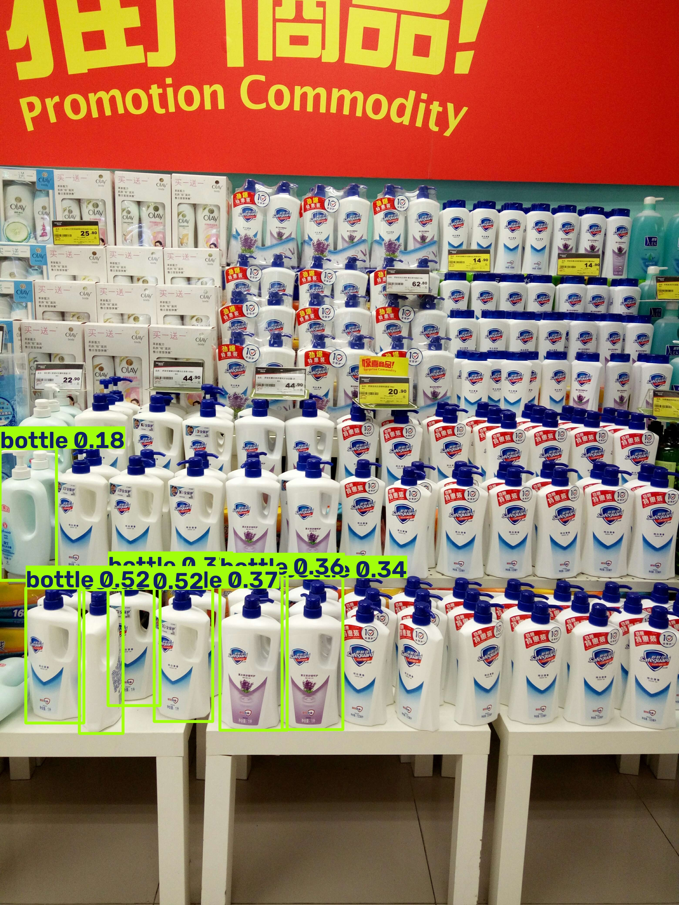
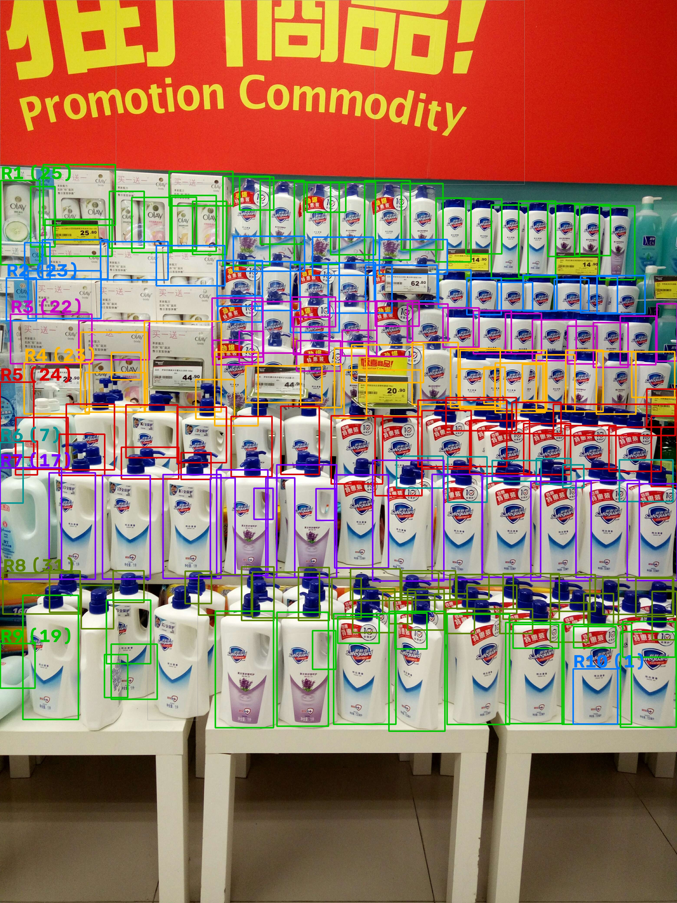
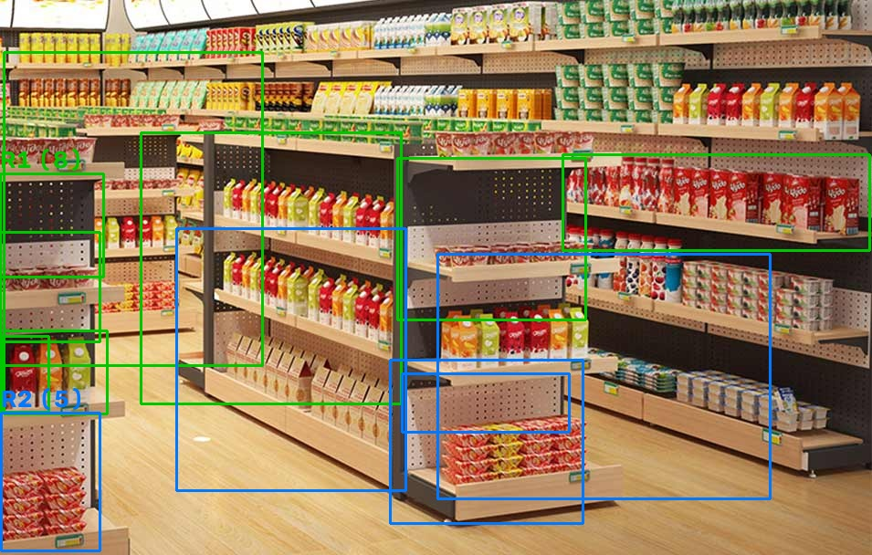
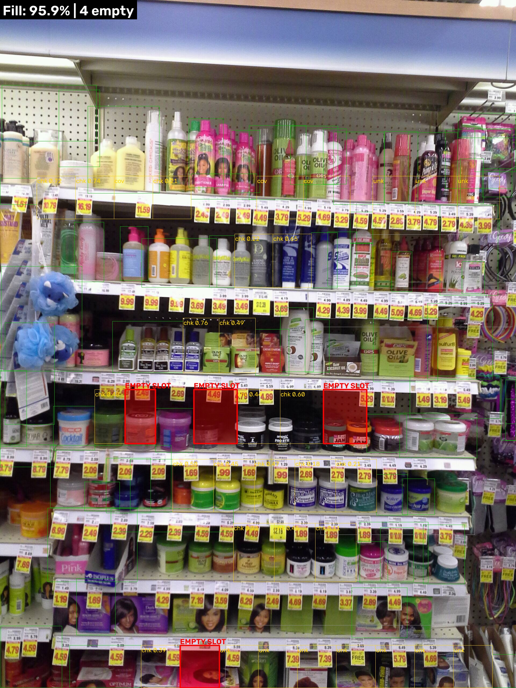
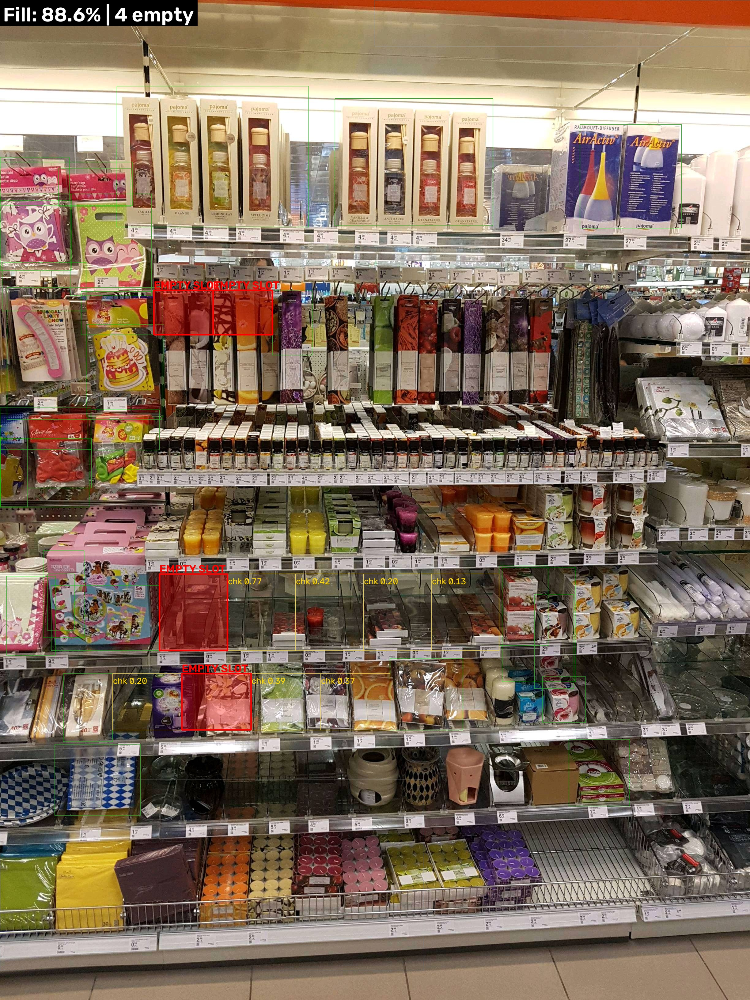

# Shelf Stock / Empty-Gap Detector

Computer Vision module for the Retail Store Analytics sprint (Nov 24 - Dec 3, 2026).

## Goal
Detect out-of-stock gaps on retail shelves using object detection and spatial bounding-box analysis.

## Output
```json
{
  "fill_rate_pct": 95.9,
  "empty_slots": [
    {"row": 5, "x1": 465, "y1": 1449, "x2": 578, "y2": 1650}
  ],
  "restock_alert": false,
  "uncertain_gaps": 32
}
```
(Example from `examples/test_2758_gaps.json`, shortened to one slot.) `fill_rate_pct` is `null` when an image has too few detected products to analyze. `uncertain_gaps` counts candidate slots the code rejected.

## Tech Stack
- Ultralytics YOLO
- OpenCV
- NumPy
- Streamlit (UI, planned)

## Setup
```bash
python -m venv venv
venv\Scripts\activate
pip install -r requirements.txt
pip install huggingface_hub
```

Download the shelf model (weights are not stored in this repo):
```bash
python -c "from huggingface_hub import hf_hub_download; hf_hub_download(repo_id='prince4332/yolov26-product-detection', filename='best.pt', local_dir='models')"
```

## Run
```bash
python baseline.py
```
Reads every image in `samples/` and saves annotated images to `outputs/`.

```bash
python shelf_rows.py
```
Filters bad boxes, groups the rest into shelf rows, and saves colored row overlays to `outputs_rows/`.

```bash
python shelf_gaps.py
```
Finds empty slots, and saves an annotated image and a JSON file per input image to `outputs_gaps/`. Pass image names (without extension) to also print the details of each decision, for example `python shelf_gaps.py test_1803 test_2758`.

## Project Structure
- `baseline.py` - runs YOLO detection on the sample images and draws boxes
- `shelf_rows.py` - box size filtering and tilt-corrected shelf row clustering
- `shelf_gaps.py` - gap detection, slot splitting, re-check, JSON metrics, annotated frames
- `samples/` - 18 retail shelf test images
- `examples/` - result images and example JSON
- `requirements.txt` - Python dependencies

## Day 2 Findings

`baseline.py` was run three times on the same 18 images:

| Run | Model | Image size | Confidence | Total boxes | Images with zero boxes |
|---|---|---|---|---|---|
| A | yolo11n.pt (general COCO model) | 640 | 0.15 | 102 | 6 |
| B | Shelf-trained model | 640 | 0.25 | 312 | 2 |
| C | Shelf-trained model | 1280 | 0.15 | 836 | 1 |

Box counts show how many detections appeared, not proven accuracy. Correctness was checked by eye on selected images.

**Before (general COCO model, 7 boxes) vs after (shelf model at 1280 px, 197 boxes) on `val_231.jpg`:**




**What I learned**
- The general COCO model has no product class, so it missed most shelf items.
- A shelf-trained model fixed most of that, and 1280 px inference found more far-away products.

**Known limits**
- When products are small and tightly packed, one box can cover several products.
- At low confidence there are some false boxes (for example on signs) and overlapping boxes in dense rows.
- Two images (`shelf image.jpg`, `shelf image2.jpg`) still get almost no detections; the cause is not yet investigated.

**Model note:** the shelf model is the community model `prince4332/yolov26-product-detection` from Hugging Face, not an official release. No model was trained or fine-tuned in this project so far; the sample images are unlabeled and used only for testing.

## Day 3 Findings

`shelf_rows.py` takes the detected boxes and turns them into shelf rows:

1. **Size filter.** Boxes much larger (over 3x) or much smaller (under 0.25x) than the image's median box are removed. Removed boxes are kept as gray "unknown zones", so gap detection does not report a gap where a merged box covered real products.
2. **Row clustering.** Each box's vertical center decides its row. Rows are sorted top to bottom, and boxes left to right.
3. **Tilt correction.** One shelf slope is estimated per image and subtracted, so angled shelves split into fewer rows.

**Examples (colors = shelf rows, gray = unknown zones):**




**What I observed (visual checks)**
- The filter removed the false boxes on the red banner and boxes over the ground in `val_231` and `test_411`.
- The model ignores the `iou` overlap setting, so duplicate removal must be done in my own code (planned for Day 7).
- Tilt correction changed row counts by one or less and did not make any checked image worse.

**Known limits**
- Only one tilt is estimated per image, so photos with strong perspective can still split a shelf into several rows (for example `train_677.jpg`).
- Overlapping boxes remain in dense areas with many small products.
- These row results were checked by eye on a few images, not measured against labeled data.

## Day 4 Findings

`shelf_gaps.py` walks each shelf row left to right and looks for empty slots:

1. **Gap rule.** A gap is `next_x1 - prev_x2` between neighboring boxes (using the furthest right edge so far, so nested boxes do not create fake gaps). A gap wider than 1.2x the median product width is a candidate. Rows with fewer than 3 boxes are ignored.
2. **Slot splitting.** A wide gap is split into product-sized slots, so one red box marks about one product position, not a whole stretch of shelf.
3. **Rejecting doubtful slots.** A candidate becomes "uncertain" (not empty) if it overlaps a gray unknown zone (`unk`), if over 30% of it is covered by other detected boxes (`cov`), or if re-running the detector on a zoomed crop at confidence 0.10 finds a product centered in it (`chk`).
4. **Metrics.** `fill_rate_pct = (1 - total empty width / total row width) x 100`. `restock_alert` is true when the fill rate is below 85%.

**Results on the 18 sample images:** 23 slots were reported empty and 172 candidate slots were rejected as uncertain. Fill rates ranged from 88.6% to 100% on the 16 images that could be analyzed; two images (`shelf image.jpg`, `shelf image2.jpg`) had too few boxes. No image triggered a restock alert.

**Examples:** `test_2758` is the best case (red boxes on individual empty slots on the middle shelf). `test_1803` shows a limit (yellow = rejected slots with the rule and re-check confidence).




**Quality limits**
- **Missed detections can appear as false empty slots.** In `test_2758`, one of the four empty slots (lowest row) appears to sit on a real product that the detector missed even at confidence 0.10.
- **The re-check can wrongly rescue bare shelf.** In `test_1803`, slots in the clear-bin area were rejected as "uncertain" even though they look bare, and one had a re-check confidence of 0.77. A confidence cutoff cannot fix this: `test_2758` has correct rescues at similar weak confidences, so I left the rule unchanged.
- **Uncertain slots count as stocked, so fill rates lean high.**
- **The restock alert never fired on the 18 images.** To check that the alert path works, the threshold was temporarily raised to 99% for one run: `restock_alert` became true on `train_439` (fill 97.4%) and stayed false on `val_231` (fill 100%). The file value stayed at 85%.
- **The 85% restock threshold is an assumption**, not from the sprint document. Change `RESTOCK_THRESHOLD` in `shelf_gaps.py` to adjust it.
- Clear bins are treated as shelf fixtures, not products. A bin with items inside counts as stocked and an empty bin as a gap. The detector does not know this, so slots in clear-bin areas can be wrong.
- These results were checked by eye on a few images, not measured against labeled data.

## Progress
- [x] Day 1: Repo setup, virtual environment, sample images
- [x] Day 2: Baseline YOLO detection and model comparison
- [x] Day 3: Box filtering and shelf row clustering
- [x] Day 4: Gap detection and JSON output
- [ ] Day 5: ShelfDetector class and CSV logging
- [ ] Day 6: Streamlit UI
- [ ] Day 7: Tuning and edge cases
- [ ] Day 8: Documentation and demo

## Author
Abdul Razaq Khan