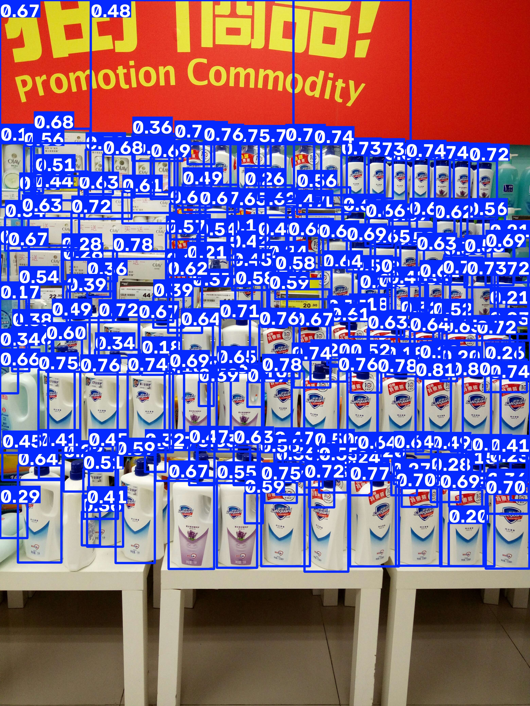

# Shelf Stock / Empty-Gap Detector

Computer Vision module for the Retail Store Analytics sprint (Nov 24 - Dec 3, 2026).

## Goal
Detect out-of-stock gaps on retail shelves using object detection and spatial bounding-box analysis.

## Planned Output
```json
{"fill_rate_pct": 0.0, "empty_slots": [], "restock_alert": false}
```

## Tech Stack
- Ultralytics YOLO
- OpenCV
- NumPy
- Streamlit (UI, planned)

## Setup
```bash
python -m venv venv
venv\Scripts\activate
pip install -r requirements.txt
pip install huggingface_hub
```

Download the shelf model (weights are not stored in this repo):
```bash
python -c "from huggingface_hub import hf_hub_download; hf_hub_download(repo_id='prince4332/yolov26-product-detection', filename='best.pt', local_dir='models')"
```

## Run
```bash
python baseline.py
```
Reads every image in `samples/` and saves annotated images to `outputs/`.

## Project Structure
- `baseline.py` - runs YOLO detection on the sample images and draws boxes
- `samples/` - 18 retail shelf test images
- `examples/` - before/after result images
- `requirements.txt` - Python dependencies

## Day 2 Findings

`baseline.py` was run three times on the same 18 images:

| Run | Model | Image size | Confidence | Total boxes | Images with zero boxes |
|---|---|---|---|---|---|
| A | yolo11n.pt (general COCO model) | 640 | 0.15 | 102 | 6 |
| B | Shelf-trained model | 640 | 0.25 | 312 | 2 |
| C | Shelf-trained model | 1280 | 0.15 | 836 | 1 |

Box counts show how many detections appeared, not proven accuracy. Correctness was checked by eye on selected images.

**Before (general COCO model, 7 boxes) vs after (shelf model at 1280 px, 197 boxes) on `val_231.jpg`:**




**What I learned**
- The general COCO model has no product class, so it missed most shelf items.
- A shelf-trained model fixed most of that, and 1280 px inference found more far-away products.

**Known limits**
- When products are small and tightly packed, one box can cover several products.
- At low confidence there are some false boxes (for example on signs) and overlapping boxes in dense rows.
- Two images (`shelf image.jpg`, `shelf image2.jpg`) still get almost no detections; the cause is not yet investigated.

**Model note:** the shelf model is the community model `prince4332/yolov26-product-detection` from Hugging Face, not an official release. No model was trained or fine-tuned in this project so far; the sample images are unlabeled and used only for testing.

## Progress
- [x] Day 1: Repo setup, virtual environment, sample images
- [x] Day 2: Baseline YOLO detection and model comparison
- [ ] Day 3: Shelf row clustering
- [ ] Day 4: Gap detection and JSON output
- [ ] Day 5: ShelfDetector class and CSV logging
- [ ] Day 6: Streamlit UI
- [ ] Day 7: Tuning and edge cases
- [ ] Day 8: Documentation and demo

## Author
Abdul Razaq Khan